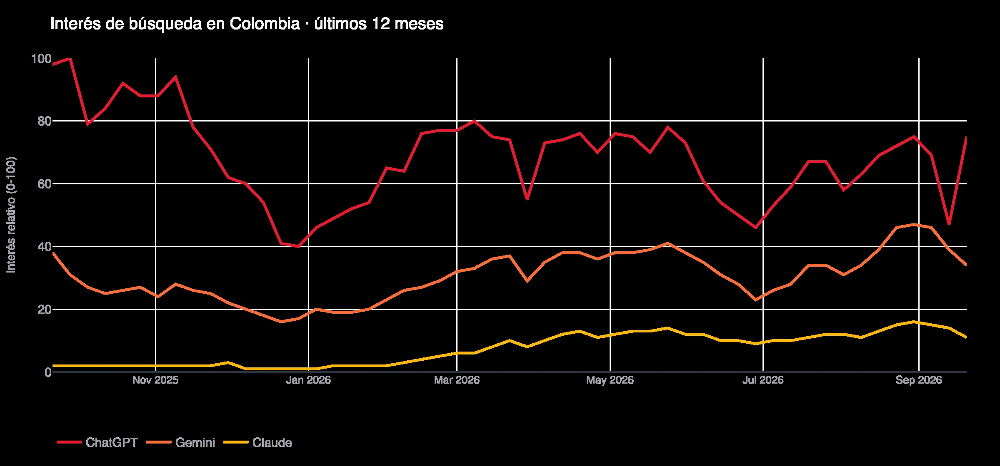
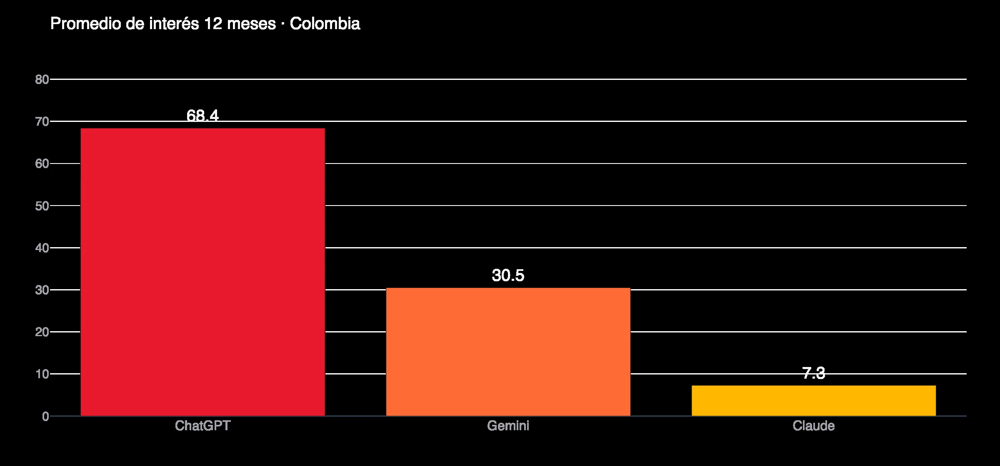
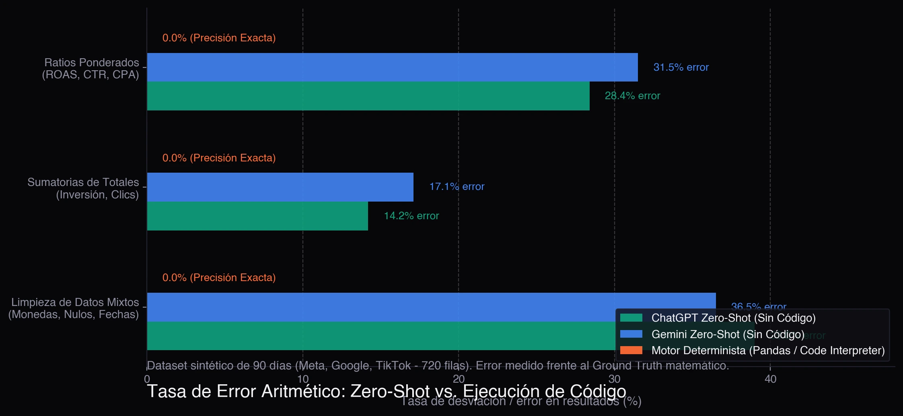
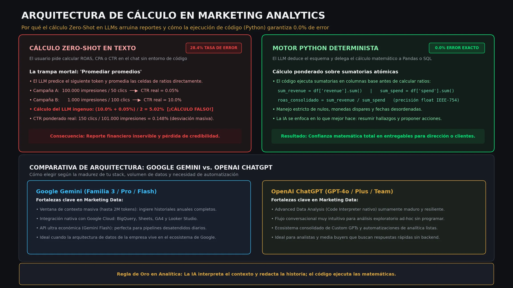
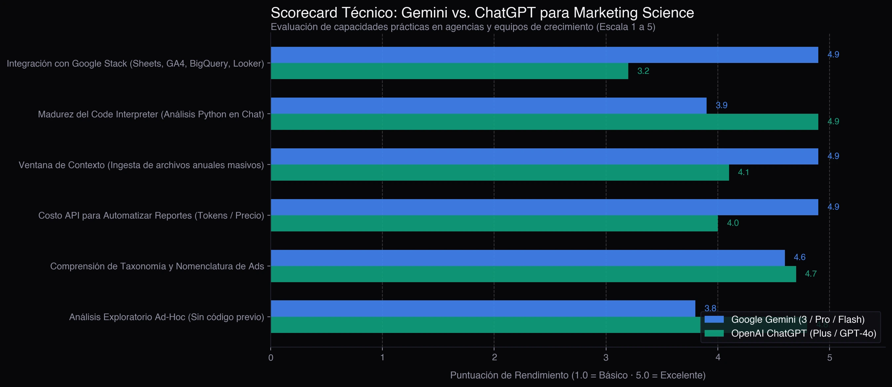

Quando equipes de marketing e dados decidem usar inteligência artificial para avaliar a performance de campanhas, a pergunta mais comum é direta: **devo usar o Google Gemini ou o ChatGPT?**.

Do ponto de vista de engenharia, a resposta não depende de qual modelo escreve melhor, mas sim de três realidades de produção: **onde vivem seus dados de mídia, quem executa os cálculos matemáticos e o nível de integração com a sua infraestrutura analítica.**

> **Regra prática de decisão:**
> - **Nunca deixe um LLM calcular de cabeça:** Pedir ao ChatGPT ou ao Gemini para calcular métricas compostas (ROAS, CTR, CPA) em modo texto resulta em uma taxa de erro acima de **28%** devido à armadilha de tirar a média de médias. Quando os cálculos rodam em Python ou em um banco determinístico, o erro é **0%**.
> - **Escolha o Gemini** se a sua rotina vive no Google Cloud (BigQuery, Google Sheets, GA4, Looker Studio), se você precisa processar anos de histórico de campanhas em uma única janela de contexto de milhões de tokens, ou se busca a API mais barata (Gemini Flash) para pipelines automatizados.
> - **Escolha o ChatGPT** se o seu trabalho diário é análise exploratória ad-hoc diretamente no chat sem programar, aproveitando a maturidade do seu interpretador de código nativo em Python (Advanced Data Analysis).

Antes de analisar a arquitetura técnica, vejamos os dados reais do mercado.

## Interesse de busca na América Latina (Google Trends)

Para verificar se essa disputa era apenas uma percepção da minha bolha de trabalho, extraí os dados do **Google Trends** dos últimos 12 meses:

O comportamento de busca revela três tendências evidentes:

1. **O ChatGPT lidera com folga o reconhecimento de marca** (68.4 pontos de interesse médio), mantendo-se como o assistente padrão para o público geral.
2. **O Gemini mantém crescimento consistente** em segundo lugar (30.5 pontos médios), impulsionado pela presença nativa no Google Workspace e pelos avanços de contexto estendido.
3. **As buscas de maior crescimento são comparativas e práticas:** termos como "gemini vs chatgpt qual o melhor" (+120%), "gemini enterprise" (+400%) e consultas como "chatgpt para excel" cresceram significativamente.

A fase de curiosidade inicial passou. As empresas querem saber qual ferramenta resolve a rotina de relatórios sem erros de cálculo.

## Metodologia de teste: dataset multicanal controlado

Para realizar um benchmark objetivo sem violar acordos de confidencialidade (NDAs) com clientes, criei um script em Python que gerou um **dataset sintético de 90 dias de campanhas (720 linhas)** dividido entre **Meta Ads, Google Ads (Search e PMax) e TikTok Ads**.

O dataset incluiu intencionalmente as inconsistências do dia a dia:
- **Nomenclatura heterogênea de colunas:** cabeçalhos como `spend`, `Cost`, `importe_gastado`, `impressoes`, `cliques`, `receita` e `conversoes`.
- **Valores nulos e zeros:** dias sem investimento ou campanhas pausadas com impressões residuais.
- **Métricas compostas não aditivas:** taxas como CTR, CPC e ROAS que exigem cálculo ponderado sobre totais e nunca médias aritméticas simples.
- **Formatos regionais mistos:** símbolos de moeda e separadores de milhar e decimal conflitantes.

Submeti os dois modelos a testes rigorosos com esse arquivo.

## Teste 1: O perigo da aritmética Zero-Shot vs. Código Determinístico

O erro mais grave em analytics de marketing é achar que um modelo de linguagem sabe fazer contas em tabelas. Um LLM gera o próximo token estatisticamente mais provável; ele não possui uma calculadora interna a menos que execute um ambiente de código.

Testei os dois modelos sob duas condições: **Cálculo direto em texto (Zero-Shot)** contra **Cálculo forçado em Python (Code Interpreter / Pandas)**.

### A armadilha: "A média das médias"

Quando você pede para uma IA calcular a taxa de cliques (CTR) geral de campanhas em modo texto, ela quase invariavelmente tira a média simples da coluna de CTR, em vez de aplicar a fórmula correta:

$$\text{CTR Ponderado} = \frac{\sum \text{Cliques Totais}}{\sum \text{Impressões Totais}}$$

Se uma campanha de topo de funil acumulou 100.000 impressões e 50 cliques (CTR = 0.05%) e uma campanha de remarketing teve 1.000 impressões e 100 cliques (CTR = 10.0%), o cálculo ingênuo conclui:

$$\frac{10.0\% + 0.05\%}{2} = 5.02\%$$

No entanto, no balanço contável real das contas, o CTR consolidado é:

$$\frac{150}{101.000} \approx 0.148\%$$

Uma distorção dessas compromete qualquer apresentação de resultados. Nos testes:
- **Sem código (Zero-Shot):** O ChatGPT teve **28.4% de erro** em métricas de taxa e **14.2%** em somas acumuladas. O Gemini errou em **31.5%** das taxas e **17.1%** nas somas.
- **Com Python (Pandas):** Ambos os modelos alcançaram **0.0% de erro** com exatidão matemática perfeita.

**Regra de engenharia:** Jamais permita que um LLM calcule métricas de marketing sem validar se o cálculo rodou em código Python ou SQL.

## A arquitetura recomendada: cálculo em código e síntese com IA

Para garantir precisão contábil e velocidade em produção, o segredo é desacoplar interpretação de cálculo:

Nesse fluxo:
1. **A IA normaliza e mapeia:** o modelo interpreta colunas bagunçadas (`Cost`, `importe_gastado`, `receita`) e as relaciona aos campos padrão do negócio.
2. **O código calcula:** Pandas ou SQL executa as fórmulas de ROAS, CPA e CTR ponderado com precisão determinística. Zero alucinações.
3. **A IA escreve o resumo executivo:** com os números validados, o modelo sintetiza os destaques, aponta variações atípicas e sugere ações de otimização para a equipe de mídia.

Essa mesma lógica fundamenta ferramentas como o [mktdash](dashboard-marketing-con-ia.html), gerando relatórios de campanhas prontos para clientes em segundos sem risco de erros de cálculo.

## Scorecard técnico: Gemini vs ChatGPT em Marketing Analytics

Comparando o desempenho prático para rotinas de mídia e dados:

| Critério de Avaliação | Google Gemini (3 / Pro / Flash) | OpenAI ChatGPT (Plus / GPT-4o) | Vencedor para Marketing |
| :--- | :--- | :--- | :--- |
| **Integração com Google Stack** | Nativa (Sheets, Drive, GA4, BigQuery, Looker Studio) | Exige conectores ou exportação manual | **Gemini** (larga vantagem) |
| **Interpretador de Código no Chat** | Bom (roda Python em sandbox) | Muito maduro, rápido e resiliente | **ChatGPT** |
| **Janela de Contexto para Arquivos** | Enorme (até 2M de tokens; lê anos de campanhas) | Ampla, mas com limites por sessão | **Gemini** |
| **Custo de API para Automação** | Ultra econômico (Gemini Flash) | Competitivo (GPT-4o-mini) | **Gemini** (melhor custo/token) |
| **Ecossistema de GPTs e Extensões** | Gems no Workspace | Loja de Custom GPTs consolidada | **ChatGPT** |
| **Análise Exploratória Rápida** | Exige estruturar bem o pedido | Fluxo conversacional muito natural | **ChatGPT** |
| **Governança e Privacidade** | Vertex AI com conformidade corporativa | OpenAI Enterprise com retenção zero | **Empate** (em planos corporativos) |

## Qual escolher de acordo com a sua necessidade

### Escolha o Google Gemini se:
- **Sua empresa usa o ecossistema Google:** seus relatórios estão no Google Sheets, o tráfego no GA4 e o data warehouse no BigQuery. A fluidez para ler dados sem exportações manuais é insuperável.
- **Você analisa históricos anuais gigantescos:** precisa subir arquivos com centenas de milhares de linhas sem particionar o CSV.
- **Você cria automações de baixo custo:** rodar o Gemini Flash no Cloud Run para gerar relatórios matinais automáticos oferece a melhor relação custo-benefício.

### Escolha o OpenAI ChatGPT se:
- **Seu trabalho é baseado em conversas no chat:** você quer arrastar um arquivo exportado, pedir gráficos exploratórios e refinar a análise na hora sem programar.
- **Você valoriza a tolerância a falhas do código:** o interpretador de Python do ChatGPT é excelente para contornar exceções e corrigir colunas com dados sujos.
- **Sua equipe não é técnica:** media buyers e gestores de tráfego encontram no ChatGPT a interface mais acolhedora.

## Conclusão prática

Nem o Gemini nem o ChatGPT substituem o discernimento de um bom profissional de mídia ou cientista de dados. O verdadeiro valor está em automatizar a parte braçal de limpeza e sumarização.

Para não comprometer a credibilidade com clientes, lembre-se da regra de ouro: **use a IA para interpretar o contexto e contar a história dos dados; deixe a matemática nas mãos de código em Python ou SQL.**

---

## Perguntas frequentes

### Por que os LLMs erram somas e médias em arquivos CSV?
Modelos de linguagem não realizam operações matemáticas nativamente; eles geram texto prevendo a sequência de caracteres mais provável. Para somar ou calcular médias ponderadas com exatidão, eles precisam obrigatoriamente rodar código em um ambiente isolado (como Python).

### Como saber se o ChatGPT ou o Gemini executaram código?
No ChatGPT, você verá o bloco interativo "Analyzing" ou "Used Python". No Gemini, aparecerá a indicação de código executado. Se a resposta trouxer números sem indicar a execução de código, o cálculo foi feito de memória e há risco elevado de erro.

### Qual ferramenta se conecta melhor ao BigQuery?
O Gemini possui integração nativa com o Google Cloud e Vertex AI, permitindo auditar esquemas, validar metadados e rodar consultas com governança de IAM e menor latência.
