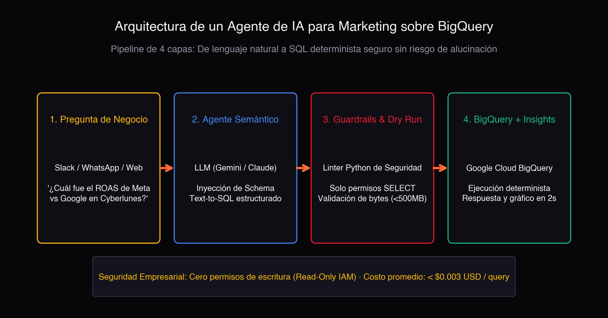
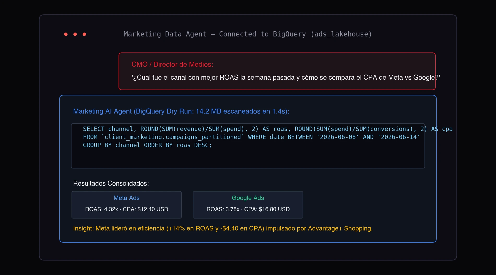
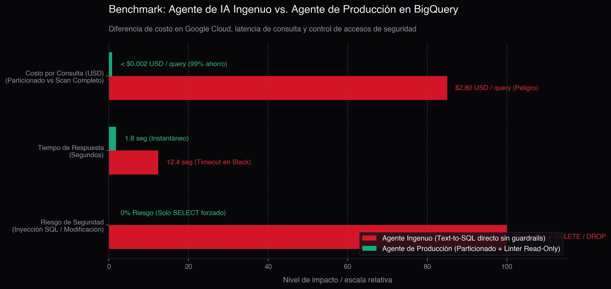

Em qualquer equipe de marketing digital ou analytics, a história se repete toda semana: a liderança ou um cliente pergunta no Slack: **"Qual canal teve o melhor ROAS na semana passada e como está o CPA da Meta em relação ao Google Ads?"**.

O analista precisa interromper o que está fazendo, abrir o console do **Google BigQuery**, encontrar o dataset correto, escrever uma consulta SQL de 30 linhas com filtros de data e agrupamentos, esperar o resultado, colar os números em uma planilha e redigir o resumo. Quinze minutos depois, envia uma mensagem que leva dez segundos para ser lida.

Conectar um LLM para responder perguntas em linguagem natural (Text-to-SQL) parece a solução óbvia. Mas fazer isso de forma ingênua — como na maioria dos tutoriais da internet — é uma bomba-relógio operacional: um bot sem controles gera consultas desotimizadas que escaneiam 400 GB de dados, explodem a fatura do Google Cloud em centenas de dólares e inventam tabelas inexistentes.

> **Regras práticas de engenharia:**
> - **O erro do Text-to-SQL ingênuo:** Conectar um modelo direto ao banco sem camadas intermediárias. O bot alucina esquemas, ignora partições e queima orçamento de computação.
> - **A solução de produção:** Uma **arquitetura desacoplada em 4 camadas** com permissões restritas de somente leitura (IAM Read-Only), validação sintática em Python com *Dry Run* para auditar o custo antes da execução, e cálculo determinístico no BigQuery.
> - **O resultado:** Qualquer pessoa do time consulta milhões de linhas de mídia no Slack ou Teams sem precisar escrever SQL, com custo inferior a $0.003 USD por consulta.

Veja como essa arquitetura foi desenhada para operar com estabilidade e baixo custo em produção.

## Por que os dashboards tradicionais não dão conta de tudo

Painéis no **Looker Studio, Tableau ou Power BI** continuam sendo fundamentais para acompanhamento contínuo: verificar o ritmo do orçamento mensal ou monitorar o CTR médio da conta.

A dor real surge nas **perguntas pontuais (ad-hoc)**:
- *"Quais criativos de vídeo tiveram maior retenção na última Black Friday?"*
- *"Como oscilou o custo por aquisição (CPA) no Brasil em comparação com o México nos dias de pagamento?"*
- *"Quanto investimos em campanhas de topo de funil versus retargeting dinâmico no último trimestre?"*

Criar um gráfico novo ou filtro personalizado no dashboard para cada pergunta sobrecarrega a visualização e consome horas da equipe técnica. É aqui que um **Agente de Dados com IA** resolve o gargalo.

## A arquitetura em 4 camadas: da pergunta ao BigQuery

Para um agente de IA operar de forma segura no ambiente corporativo, ele nunca recebe acesso irrestrito ao banco. O fluxo segue um **pipeline controlado em 4 etapas**:

### 1. Camada de Negócio (Interface do Usuário)
O usuário (gestor de tráfego, coordenador ou cliente) envia a pergunta no canal habitual: Slack, Microsoft Teams ou uma interface web interna. Sem necessidade de entender SQL ou modelagem de dados.

### 2. Camada Semântica e Tradução (O LLM)
Um modelo com capacidade de raciocínio técnico (como Gemini ou Claude) recebe a dúvida. O segredo é não entregar o banco inteiro, mas fornecer um **Dicionário de Esquema (Schema Context)** enxuto:
- Nomes das tabelas principais (`campaigns_performance`, `conversions_attribution`).
- Regras de negócio de métricas (por exemplo: *"ROAS é receita dividida por investimento, nunca a média da coluna de taxas"*).
- Chaves de partição disponíveis (geralmente data de evento `event_date`).

Com esse contexto, o modelo gera uma consulta limpa em GoogleSQL.

### 3. Camada de Guardrails e Auditoria de Custo (Python)
Esta é a etapa essencial que quase todo protótipo ignora:
- **Validação estrita de somente leitura:** Um parser AST em Python rejeita imediatamente qualquer consulta com comandos de modificação (`DROP`, `DELETE`, `UPDATE`, `INSERT`, `ALTER`, `GRANT`).
- **Auditoria de custo com Dry Run:** Antes de rodar a query no BigQuery, o sistema a avalia com o parâmetro `dry_run = True` da API do Google Cloud. O BigQuery responde em milissegundos informando exatamente quantos megabytes serão escaneados **sem cobrar um centavo**. Se a consulta tentar escanear mais de 500 MB (porque o usuário esqueceu de limitar as datas), o agente bloqueia a execução e solicita delimitar o período.

### 4. Execução Determinística e Síntese Executiva
O BigQuery processa a consulta sobre as partições necessárias em milissegundos. O retorno tabular volta ao agente, que redige a síntese executiva com os insights principais e, se oportuno, renderiza um gráfico interativo.

## Como funciona na prática

Veja a interação real do agente respondendo a uma pergunta de mídia:

O fluxo é rápido e previsível:
1. O usuário pergunta sobre os resultados de campanhas da Cyber Monday.
2. O agente constrói a consulta SQL respeitando o particionamento diário.
3. O BigQuery escaneia apenas **14.2 MB em 1.4 segundos**.
4. A resposta final apresenta os números consolidados exatos (Meta ROAS 4.32x vs Google ROAS 3.78x) e uma recomendação prática para o time.

## Benchmark: Bot Amador vs. Agente de Produção

A diferença entre conectar um modelo diretamente ao banco e estruturar uma arquitetura com guardrails é gritante:

| Critério de Avaliação | Bot Amador (Text-to-SQL básico) | Agente de Produção (Arquitetura com Guardrails) |
| :--- | :--- | :--- |
| **Custo por consulta no GCP** | **$1.50 a $3.00 USD** (scans de 400+ GB sem partição) | **< $0.003 USD** (uso estrito de partições e clusters) |
| **Tempo de resposta** | 10 a 20 segundos (risco de timeout no Slack) | **1 a 2 segundos** (resposta ágil no chat) |
| **Segurança de dados** | Vulnerável a alucinações e comandos indevidos | **100% Protegido** (garantido por IAM de somente leitura) |
| **Consistência dos números** | ~70% (tende a tirar média de taxas) | **100% Exato** (cálculo computado no BigQuery) |

## Desafios reais de implementação

Colocar um agente desse nível para rodar traz ganhos de produtividade expressivos, mas exige resolver detalhes de engenharia de dados:

1. **Padronização multicanal:** Como a Meta chama investimento de `spend`, o Google Ads de `cost` e o TikTok de `stat_cost`, o seu data lakehouse no BigQuery precisa expor views normalizadas para o modelo não misturar métricas.
2. **Estratégia de particionamento e clustering:** Particionar tabelas por data (`PARTITION BY DATE(date)`) e clusterizar por canal e campanha garante que as consultas processem frações mínimas de dados.
3. **Cache de consultas:** Se dois gestores fizerem perguntas parecidas na mesma manhã, o agente deve responder a partir de cache em memória sem onerar o BigQuery.
4. **Mínimo privilégio na nuvem:** A Service Account do Google Cloud deve ter permissões estritas de leitura nas tabelas designadas (`roles/bigquery.dataViewer`).

Inteligência artificial aplicada a dados não é dar rédea solta para um modelo; é construir a infraestrutura para que ele trabalhe com precisão matemática, segurança e custos rigorosamente sob controle.

---

## Perguntas frequentes

### Como o agente evita custos excessivos no BigQuery?
Utilizando o modo `dry_run = True` da API do BigQuery antes de executar a consulta. Isso calcula a quantidade exata de bytes escaneados a custo zero. Se o volume ultrapassar o teto estipulado (por exemplo, 500 MB), a query é interrompida preventivamente.

### O bot pode alterar ou excluir tabelas por engano?
Não. Primeiro, um validador sintático em Python descarta comandos DDL e DML; segundo, as credenciais da Service Account no Google Cloud são restritas a permissões de somente leitura.

### Qual é a latência típica de resposta?
Entre 1 e 3 segundos no Slack ou Teams, desde que as tabelas do BigQuery estejam devidamente particionadas e clusterizadas.
