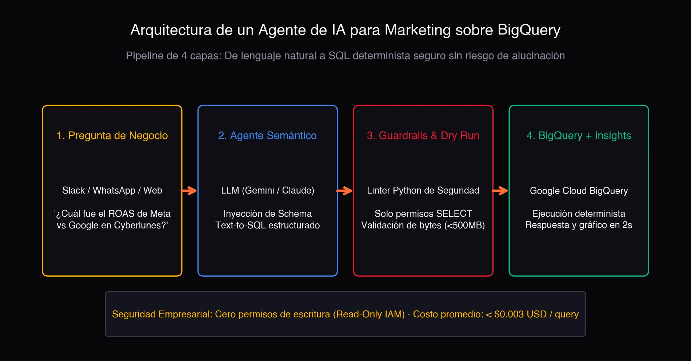

Extracting web data at scale for e-commerce and telecom intelligence has always been a game of two extremes. On one side, deterministic parsers (XPath/CSS via `lxml` and `parsel`) have near-zero marginal cost and millisecond latency, but break the moment the frontend mutates the DOM. On the other, sending raw HTML through a large LLM fixes the fragility, but at prohibitive token cost, high latency, and an indirect prompt-injection attack surface nobody wants in production.

That is the trade-off we tackle in the technical note **Self-Healing Web Data Extraction Pipelines: Combining Lightweight LLMs and Deterministic Parsers for E-Commerce and Telecom Intelligence** ([Zenodo, 2026; DOI: 10.5281/zenodo.24064916](https://doi.org/10.5281/zenodo.24064916), Report ID UNAL-CS-2026-TN02). The answer is not picking a side: it is decoupling routine parsing from LLM-assisted recovery.

## The problem: the DOM changes, the LLM is expensive

In production, a scraper does not fail because the model is dumb; it fails because a CSS class was renamed, a container got wrapped in a new `div`, or the site moved to client-side rendering. The XPath selector that worked yesterday returns empty today, and the pipeline stalls until someone rewrites the rule by hand.

The obvious temptation is "send the HTML to the LLM and let it extract the fields." It works in demos, but in production it is a bad idea for three reasons:

- **Cost**: tokenizing a full page per extraction multiplies the inference bill by thousands.
- **Latency**: the model round-trip adds hundreds of milliseconds per record.
- **Security**: HTML is untrusted input. If an attacker injects a payload into the scraped page, the LLM can be manipulated into executing actions outside its contract (indirect prompt injection).

## The architecture: deterministic parsing plus LLM recovery

The pipeline runs on serverless workers (Cloud Run) and operates in two modes:

### Normal mode: deterministic selectors plus strict schemas

Under normal operation, extraction relies strictly on XPath/CSS selectors validated against strict **Pydantic** schemas. No model calls, no tokens, no extra latency. Marginal cost is practically zero and latency is measured in milliseconds.

### Recovery mode: anomaly circuit breaker

When a schema violation or structural drift trips the anomaly circuit breaker, the system enters recovery mode with four steps:

1. **LCA DOM pruning**: the mutated HTML region is isolated using the Lowest Common Ancestor, discarding the rest of the page.
2. **Cryptographic boundaries**: the untrusted snippet is encapsulated within signed XML boundaries with cryptographic nonces, mitigating indirect prompt injection (the same primitive detailed in [TN01](https://doi.org/10.5281/zenodo.22886108)).
3. **Lightweight LLM out-of-band**: only at this point is a lightweight LLM invoked, and solely to synthesize a patched XPath/CSS selector. It does not extract data or decide flows; it only proposes a rule.
4. **Sandbox verification**: the new selector is validated against historical schema invariants in an isolated environment. If it passes, it hot-swaps into the production registry.

## Result: over 98% fewer tokens

Evaluated across Latin American and Colombian retail and telecom portals, the hybrid pipeline resolves layout breaks autonomously, with no human intervention, reducing token consumption by over **98%** compared to full-page LLM scraping.

The key is that the model never sees the whole page: only the mutated fragment, and only when the deterministic parser fails. 99% of the work is done by code; the remaining 1% is delegated to the model under a tightly scoped contract.

## Relation to the previous note (TN01)

This report is the second technical note in the series (UNAL-CS-2026-TN02) and directly cites the first, **Mitigating Direct and Indirect Prompt Injection in Production LLM Agents** (UNAL-CS-2026-TN01). The cryptographic nonce boundaries protecting the scraped snippet are the same defense primitive I designed for production LLM agents.

## References

- Urrego Lancheros, J. D. (2026). *Self-Healing Web Data Extraction Pipelines: Combining Lightweight LLMs and Deterministic Parsers for E-Commerce and Telecom Intelligence*. Technical Note UNAL-CS-2026-TN02. Universidad Nacional de Colombia / Zenodo. DOI: [10.5281/zenodo.24064916](https://doi.org/10.5281/zenodo.24064916).
- Urrego Lancheros, J. D. (2026). *Mitigating Direct and Indirect Prompt Injection in Production LLM Agents*. Technical Note UNAL-CS-2026-TN01. Universidad Nacional de Colombia / Zenodo.
- Greshake, K., et al. (2023). *Not what you've signed up for: Compromising real-world LLM-integrated applications with indirect prompt injection*. AISEC.
- Gur, I., et al. (2024). *A Real-World WebAgent with Planning, Long Context Understanding, and Program Synthesis*. ICLR.
- Deng, X., et al. (2023). *Mind2Web*. NeurIPS.
- Yao, S., et al. (2023). *ReAct*. ICLR.
