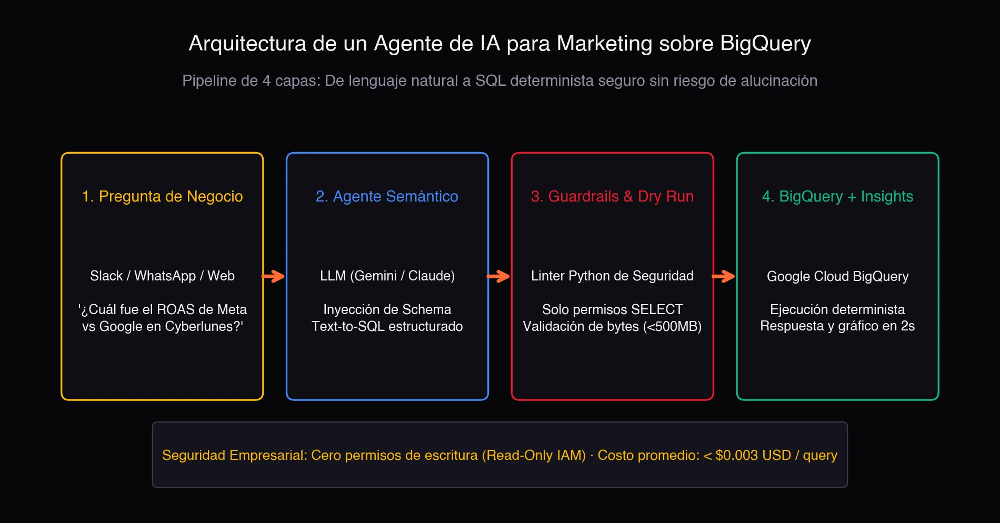

Extraer datos de la web a escala para inteligencia de e-commerce y telecomunicaciones siempre ha sido un juego de dos extremos. Por un lado, los parsers deterministas (XPath/CSS con `lxml` y `parsel`) tienen costo marginal casi cero y latencia de milisegundos, pero se rompen en cuanto el frontend muta el DOM. Por el otro, enviar el HTML crudo a un LLM grande resuelve la fragilidad, pero a un costo de tokens prohibitivo, con latencia alta y una superficie de ataque de *prompt injection* indirecta que nadie quiere en producción.

Ese es el trade-off que atacamos en la nota técnica **Self-Healing Web Data Extraction Pipelines: Combining Lightweight LLMs and Deterministic Parsers for E-Commerce and Telecom Intelligence** ([Zenodo, 2026; DOI: 10.5281/zenodo.24064916](https://doi.org/10.5281/zenodo.24064916), Report ID UNAL-CS-2026-TN02). Y la respuesta no es elegir un bando: es desacoplar el parseo rutinario de la recuperación asistida por LLM.

## El problema: el DOM cambia, el LLM es caro

En producción, un scraper no falla porque el modelo sea tonto: falla porque una clase CSS cambió de nombre, un contenedor se envolvió en un `div` nuevo o el sitio migró a renderizado client-side. El selector XPath que ayer funcionaba hoy devuelve vacío, y el pipeline se detiene hasta que alguien reescribe la regla a mano.

La tentación obvia es "mandémosle el HTML al LLM y que extraiga los campos". Funciona en demos, pero en producción es una mala idea por tres razones:

- **Costo**: tokenizar una página completa por cada extracción multiplica la factura de inferencia por miles.
- **Latencia**: el round-trip al modelo añade cientos de milisegundos por registro.
- **Seguridad**: el HTML es entrada no confiable. Si un atacante inyecta un payload en la página scrapeada, el LLM puede ser manipulado para ejecutar acciones fuera de su contrato (inyección indirecta de prompt).

## La arquitectura: parseo determinista + recuperación con LLM

El pipeline se despliega sobre workers serverless (Cloud Run) y opera en dos modos:

### Modo normal: selectores deterministas + esquemas estrictos

Bajo operación normal, la extracción se basa únicamente en selectores XPath/CSS validados contra esquemas estrictos de **Pydantic**. Sin llamadas a modelos, sin tokens, sin latencia extra. El costo marginal es prácticamente cero y la latencia se mide en milisegundos.

### Modo recuperación: circuit breaker de anomalías

Cuando una violación de esquema o una deriva estructural dispara el *circuit breaker* de anomalías, el sistema entra en modo recuperación con cuatro pasos:

1. **Poda DOM por LCA**: se aísla la región mutada del HTML usando el ancestro común más bajo (Lowest Common Ancestor), descartando el resto de la página.
2. **Fronteras criptográficas**: el snippet no confiable se encapsula dentro de límites XML firmados con nonces criptográficos, mitigando la inyección indirecta de prompt (la misma técnica que detallé en [TN01](https://doi.org/10.5281/zenodo.22886108)).
3. **LLM ligero fuera de banda**: solo en este punto se invoca un LLM ligero, y únicamente para sintetizar un selector XPath/CSS parcheado. No extrae datos, no decide flujos: solo propone una regla.
4. **Verificación en sandbox**: el nuevo selector se valida contra invariantes históricos del esquema en un entorno aislado. Si pasa, se hace *hot-swap* en el registro de producción.

## Resultado: más del 98% menos tokens

Evaluado sobre portales minoristas y de telecomunicaciones de Latinoamérica y Colombia, el pipeline híbrido resuelve las roturas de layout de forma autónoma, sin intervención humana, reduciendo el consumo de tokens en más del **98%** frente al scraping completo con LLM.

La clave está en que el modelo nunca ve la página entera: solo el fragmento mutado, y solo cuando el parser determinista falla. El 99% del trabajo se hace con código, y el 1% restante se delega al modelo con un contrato muy acotado.

## Relación con la nota anterior (TN01)

Este reporte es la segunda nota técnica de la serie (UNAL-CS-2026-TN02) y cita directamente a la primera, **Mitigating Direct and Indirect Prompt Injection in Production LLM Agents** (UNAL-CS-2026-TN01). Las fronteras criptográficas con nonces que protegen el snippet scrapeado son la misma primitiva de defensa que diseñé para agentes LLM en producción.

## Referencias

- Urrego Lancheros, J. D. (2026). *Self-Healing Web Data Extraction Pipelines: Combining Lightweight LLMs and Deterministic Parsers for E-Commerce and Telecom Intelligence*. Technical Note UNAL-CS-2026-TN02. Universidad Nacional de Colombia / Zenodo. DOI: [10.5281/zenodo.24064916](https://doi.org/10.5281/zenodo.24064916).
- Urrego Lancheros, J. D. (2026). *Mitigating Direct and Indirect Prompt Injection in Production LLM Agents*. Technical Note UNAL-CS-2026-TN01. Universidad Nacional de Colombia / Zenodo.
- Greshake, K., et al. (2023). *Not what you've signed up for: Compromising real-world LLM-integrated applications with indirect prompt injection*. AISEC.
- Gur, I., et al. (2024). *A Real-World WebAgent with Planning, Long Context Understanding, and Program Synthesis*. ICLR.
- Deng, X., et al. (2023). *Mind2Web*. NeurIPS.
- Yao, S., et al. (2023). *ReAct*. ICLR.