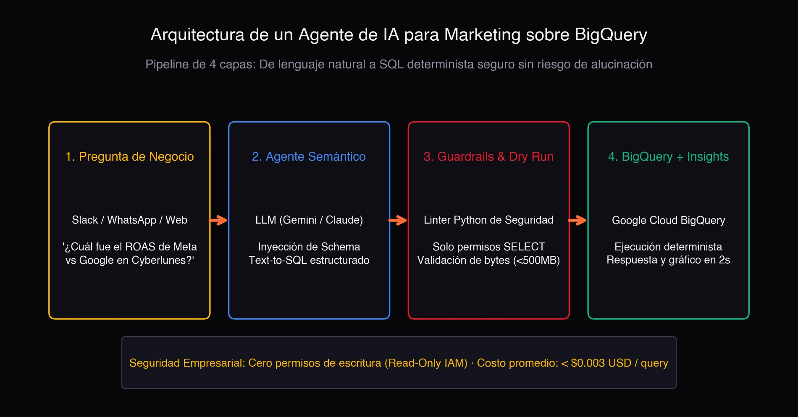

Extrair dados da web em escala para inteligência de e-commerce e telecomunicações sempre foi um jogo de dois extremos. De um lado, parsers determinísticos (XPath/CSS via `lxml` e `parsel`) têm custo marginal quase zero e latência de milissegundos, mas quebram assim que o frontend muta o DOM. Do outro, enviar o HTML bruto para um LLM grande resolve a fragilidade, mas a um custo de tokens proibitivo, com alta latência e uma superfície de ataque de *prompt injection* indireta que ninguém quer em produção.

Esse é o trade-off que atacamos na nota técnica **Self-Healing Web Data Extraction Pipelines: Combining Lightweight LLMs and Deterministic Parsers for E-Commerce and Telecom Intelligence** ([Zenodo, 2026; DOI: 10.5281/zenodo.24064916](https://doi.org/10.5281/zenodo.24064916), Report ID UNAL-CS-2026-TN02). E a resposta não é escolher um lado: é desacoplar o parsing rotineiro da recuperação assistida por LLM.

## O problema: o DOM muda, o LLM é caro

Em produção, um scraper não falha porque o modelo seja burro; falha porque uma classe CSS mudou de nome, um container foi envolvido em um novo `div` ou o site migrou para renderização client-side. O seletor XPath que funcionava ontem retorna vazio hoje, e o pipeline para até alguém reescrever a regra à mão.

A tentação óbvia é "mandar o HTML para o LLM e deixar ele extrair os campos". Funciona em demos, mas em produção é uma má ideia por três razões:

- **Custo**: tokenizar uma página inteira por extração multiplica a conta de inferência por milhares.
- **Latência**: o round-trip ao modelo adiciona centenas de milissegundos por registro.
- **Segurança**: HTML é entrada não confiável. Se um atacante injetar um payload na página raspada, o LLM pode ser manipulado para executar ações fora de seu contrato (prompt injection indireta).

## A arquitetura: parsing determinístico mais recuperação com LLM

O pipeline roda em workers serverless (Cloud Run) e opera em dois modos:

### Modo normal: seletores determinísticos mais esquemas estritos

Sob operação normal, a extração se baseia unicamente em seletores XPath/CSS validados contra esquemas estritos de **Pydantic**. Sem chamadas a modelos, sem tokens, sem latência extra. O custo marginal é praticamente zero e a latência se mede em milissegundos.

### Modo recuperação: circuit breaker de anomalias

Quando uma violação de esquema ou deriva estrutural dispara o *circuit breaker* de anomalias, o sistema entra em modo de recuperação com quatro passos:

1. **Poda DOM por LCA**: a região mutada do HTML é isolada usando o Lowest Common Ancestor, descartando o resto da página.
2. **Fronteiras criptográficas**: o snippet não confiável é encapsulado dentro de limites XML assinados com nonces criptográficos, mitigando prompt injection indireta (a mesma primitiva detalhada em [TN01](https://doi.org/10.5281/zenodo.22886108)).
3. **LLM leve fora de banda**: só neste ponto um LLM leve é invocado, e apenas para sintetizar um seletor XPath/CSS corrigido. Não extrai dados nem decide fluxos; só propõe uma regra.
4. **Verificação em sandbox**: o novo seletor é validado contra invariantes históricos do esquema em um ambiente isolado. Se passar, faz *hot-swap* no registro de produção.

## Resultado: mais de 98% menos tokens

Avaliado sobre portais de varejo e telecomunicações da América Latina e da Colômbia, o pipeline híbrido resolve as quebras de layout de forma autônoma, sem intervenção humana, reduzindo o consumo de tokens em mais de **98%** em comparação com scraping completo via LLM.

A chave é que o modelo nunca vê a página inteira: apenas o fragmento mutado, e só quando o parser determinístico falha. 99% do trabalho é feito por código; os 1% restantes são delegados ao modelo sob um contrato muito restrito.

## Relação com a nota anterior (TN01)

Este reporte é a segunda nota técnica da série (UNAL-CS-2026-TN02) e cita diretamente a primeira, **Mitigating Direct and Indirect Prompt Injection in Production LLM Agents** (UNAL-CS-2026-TN01). As fronteiras criptográficas com nonces que protegem o snippet raspado são a mesma primitiva de defesa que projetei para agentes LLM em produção.

## Referências

- Urrego Lancheros, J. D. (2026). *Self-Healing Web Data Extraction Pipelines: Combining Lightweight LLMs and Deterministic Parsers for E-Commerce and Telecom Intelligence*. Technical Note UNAL-CS-2026-TN02. Universidad Nacional de Colombia / Zenodo. DOI: [10.5281/zenodo.24064916](https://doi.org/10.5281/zenodo.24064916).
- Urrego Lancheros, J. D. (2026). *Mitigating Direct and Indirect Prompt Injection in Production LLM Agents*. Technical Note UNAL-CS-2026-TN01. Universidad Nacional de Colombia / Zenodo.
- Greshake, K., et al. (2023). *Not what you've signed up for: Compromising real-world LLM-integrated applications with indirect prompt injection*. AISEC.
- Gur, I., et al. (2024). *A Real-World WebAgent with Planning, Long Context Understanding, and Program Synthesis*. ICLR.
- Deng, X., et al. (2023). *Mind2Web*. NeurIPS.
- Yao, S., et al. (2023). *ReAct*. ICLR.
